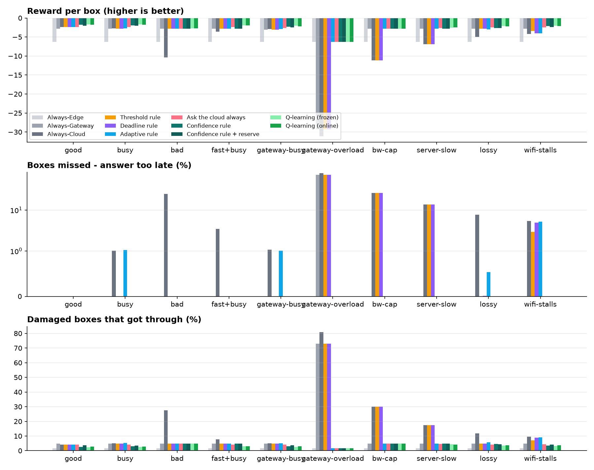
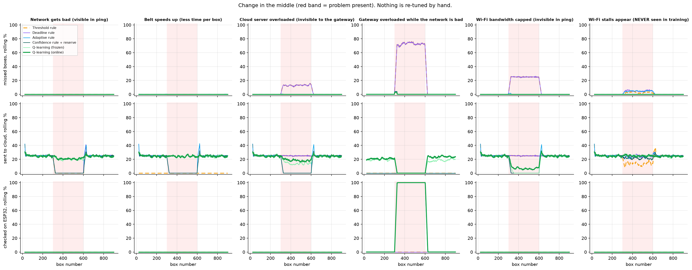
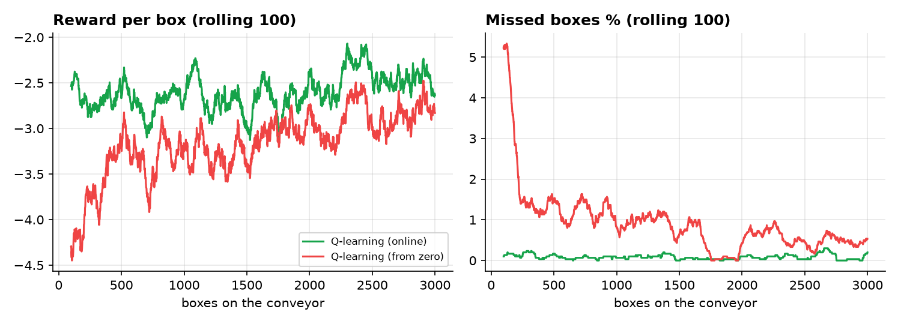
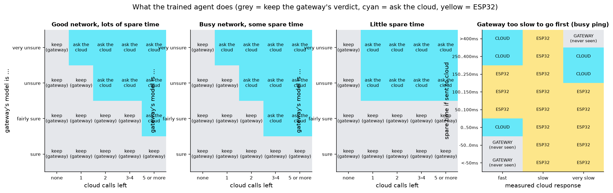
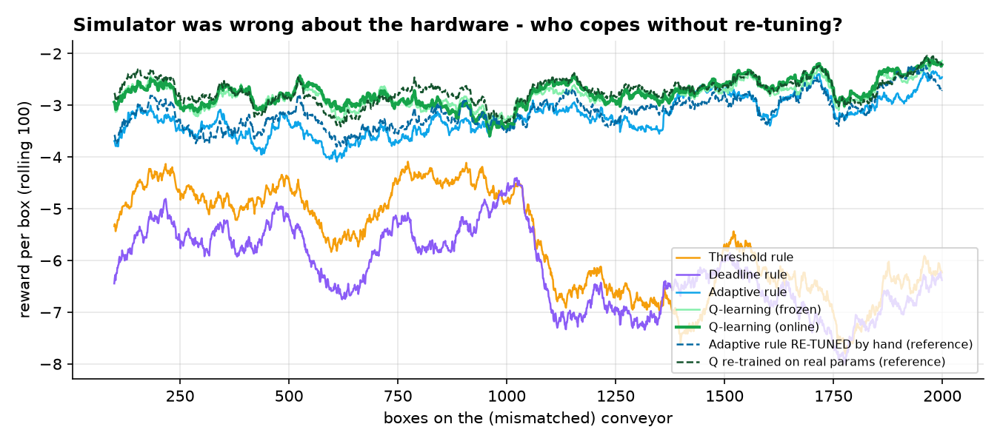
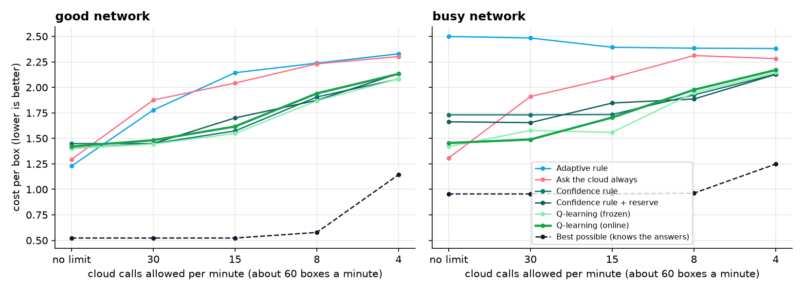
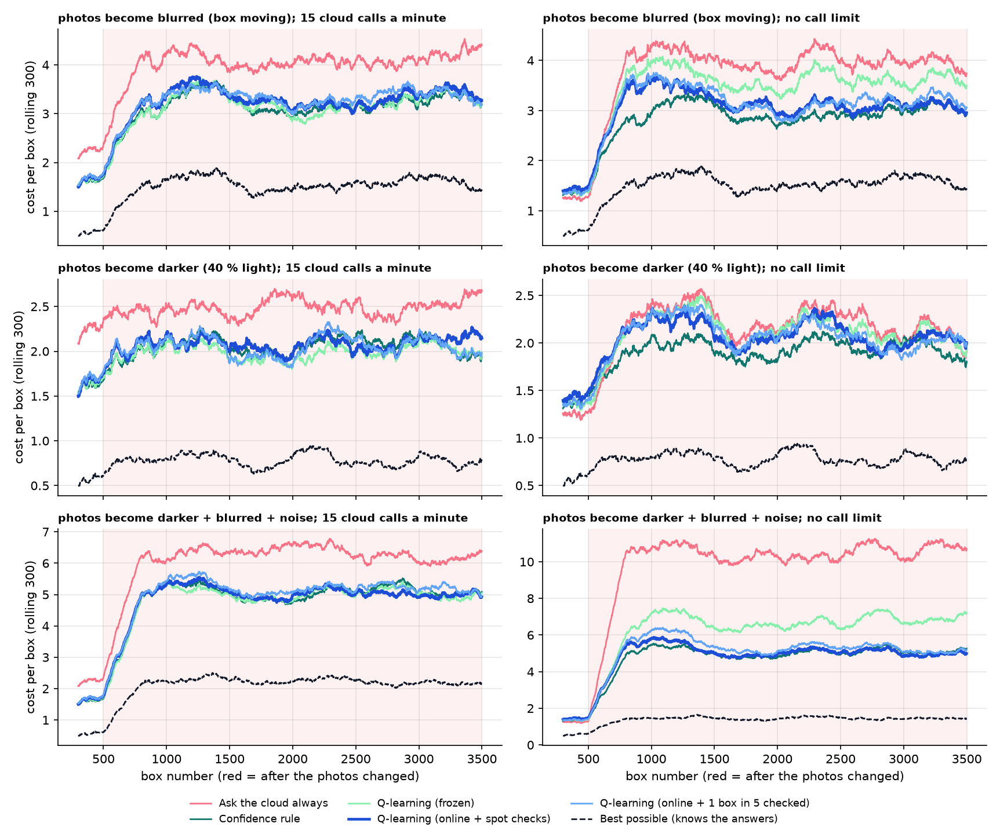

# Simulation results (auto-generated by `python -m sim.experiments`)

> These are **simulated** results from the calibrated conveyor simulator. Repeat them on the real conveyor with `tools/run_experiment.py` + `tools/report_real.py`.

Generated: 2026-11-26 01:07

Boxes are replayed photos: **public photos, data\public** (594 test photos; the agent and the rules were trained and tuned on 588 other photos). "Reward" in every table is minus the real cost of what happened to each box (100 for a shipped damaged box, 10 for a wasted good one, 5 plus the damage for an unchecked one). All policies see the same boxes.

E1 and E2 run with a cloud-call limit of **15 per minute** (about one box in four at one box a second). A pick-one policy that wants the cloud without a call left gets the gateway instead.

## Reward per box (what the agent optimises)

- checked on the ESP32 in time: **-6.29**  
- checked on the gateway in time: **-2.52**  
- checked on the cloud in time: **-1.23**  
- missed (box passed unchecked): **-35.00**

- gateway sure (34% of boxes): keep its verdict **-0.18**, cloud answer **-0.53**
- gateway fairly sure (31% of boxes): keep its verdict **-1.41**, cloud answer **-1.13**
- gateway unsure (22% of boxes): keep its verdict **-2.22**, cloud answer **-1.05**
- gateway very unsure (14% of boxes): keep its verdict **-4.65**, cloud answer **-1.84**

Model quality used: {"esp32": {"recall_damaged": 0.9799, "false_reject_rate": 0.8122, "accuracy": 0.6532}, "gateway": {"recall_damaged": 0.9599, "false_reject_rate": 0.1878, "accuracy": 0.899}, "cloud": {"recall_damaged": 0.9771, "false_reject_rate": 0.0776, "accuracy": 0.9545}}

## E1 - Steady conditions (mean of 20 runs x 400 boxes)

`wifi-stalls` (20% of cloud requests freeze 0.4-0.8 s, e.g. microwave-oven interference) was NEVER part of pre-training or rule tuning.

**Reward per box** (higher is better; best in bold)

| scenario | Always-Edge | Always-Gateway | Always-Cloud | Threshold rule | Deadline rule | Adaptive rule | Ask the cloud always | Confidence rule | Confidence rule + reserve | Q-learning (frozen) | Q-learning (online) |
|---|---|---|---|---|---|---|---|---|---|---|---|
| good | -6.32 | -2.78 | -2.36 | -2.36 | -2.36 | -2.36 | -2.41 | -1.74 | -2.04 | **-1.67** | -1.80 |
| busy | -6.32 | -2.78 | -2.71 | -2.78 | -2.78 | -2.74 | -2.40 | -1.96 | -2.07 | **-1.72** | -1.82 |
| bad | -6.32 | -2.78 | -10.38 | -2.78 | -2.78 | -2.78 | -2.80 | -2.78 | -2.78 | **-2.77** | -2.77 |
| fast+busy | -6.32 | -2.78 | -3.59 | -2.78 | -2.78 | -2.78 | -2.41 | -2.78 | -2.78 | -1.96 | **-1.91** |
| gateway-busy | -6.32 | -3.04 | -2.94 | -3.04 | -3.04 | -2.93 | -2.69 | -2.34 | -2.52 | **-2.01** | -2.19 |
| gateway-overload | **-6.32** | -29.31 | -31.15 | -29.31 | -29.31 | **-6.32** | **-6.32** | **-6.32** | **-6.32** | **-6.32** | **-6.32** |
| bw-cap | -6.32 | -2.78 | -11.15 | -11.15 | -11.15 | -2.78 | -2.86 | **-2.78** | **-2.78** | **-2.78** | -2.80 |
| server-slow | -6.32 | -2.78 | -6.90 | -6.90 | -6.90 | -2.78 | -2.63 | -2.78 | -2.78 | -2.59 | **-2.49** |
| lossy | -6.32 | -2.78 | -4.98 | -2.78 | -2.78 | -3.02 | -2.48 | -2.69 | -2.65 | **-2.13** | -2.18 |
| wifi-stalls | -6.32 | -2.78 | -4.24 | -3.46 | -4.03 | -4.01 | -2.47 | -2.16 | -2.40 | **-2.02** | -2.12 |

**Missed boxes %**

| scenario | Always-Edge | Always-Gateway | Always-Cloud | Threshold rule | Deadline rule | Adaptive rule | Ask the cloud always | Confidence rule | Confidence rule + reserve | Q-learning (frozen) | Q-learning (online) |
|---|---|---|---|---|---|---|---|---|---|---|---|
| good | 0.0 | 0.0 | 0.0 | 0.0 | 0.0 | 0.0 | 0.0 | 0.0 | 0.0 | 0.0 | 0.0 |
| busy | 0.0 | 0.0 | 1.0 | 0.0 | 0.0 | 1.1 | 0.0 | 0.0 | 0.0 | 0.0 | 0.0 |
| bad | 0.0 | 0.0 | 24.8 | 0.0 | 0.0 | 0.0 | 0.0 | 0.0 | 0.0 | 0.0 | 0.0 |
| fast+busy | 0.0 | 0.0 | 3.5 | 0.0 | 0.0 | 0.0 | 0.0 | 0.0 | 0.0 | 0.0 | 0.0 |
| gateway-busy | 0.0 | 0.0 | 1.1 | 0.0 | 0.0 | 1.0 | 0.0 | 0.0 | 0.0 | 0.0 | 0.0 |
| gateway-overload | 0.0 | 73.0 | 80.0 | 73.0 | 73.0 | 0.0 | 0.0 | 0.0 | 0.0 | 0.0 | 0.0 |
| bw-cap | 0.0 | 0.0 | 26.1 | 26.1 | 26.1 | 0.0 | 0.0 | 0.0 | 0.0 | 0.0 | 0.0 |
| server-slow | 0.0 | 0.0 | 13.7 | 13.7 | 13.7 | 0.0 | 0.0 | 0.0 | 0.0 | 0.0 | 0.0 |
| lossy | 0.0 | 0.0 | 7.7 | 0.0 | 0.0 | 0.5 | 0.0 | 0.0 | 0.0 | 0.0 | 0.0 |
| wifi-stalls | 0.0 | 0.0 | 5.4 | 2.9 | 5.0 | 5.2 | 0.0 | 0.0 | 0.0 | 0.0 | 0.0 |

**Damaged boxes that got through %**

| scenario | Always-Edge | Always-Gateway | Always-Cloud | Threshold rule | Deadline rule | Adaptive rule | Ask the cloud always | Confidence rule | Confidence rule + reserve | Q-learning (frozen) | Q-learning (online) |
|---|---|---|---|---|---|---|---|---|---|---|---|
| good | 1.7 | 4.8 | 4.0 | 4.0 | 4.0 | 4.0 | 4.1 | 2.5 | 3.7 | 2.4 | 2.8 |
| busy | 1.7 | 4.8 | 5.0 | 4.8 | 4.8 | 5.3 | 4.0 | 3.0 | 3.5 | 2.5 | 2.8 |
| bad | 1.7 | 4.8 | 27.6 | 4.8 | 4.8 | 4.8 | 4.8 | 4.8 | 4.8 | 4.7 | 4.7 |
| fast+busy | 1.7 | 4.8 | 7.7 | 4.8 | 4.8 | 4.8 | 4.0 | 4.8 | 4.8 | 3.0 | 2.9 |
| gateway-busy | 1.7 | 4.8 | 5.1 | 4.8 | 4.8 | 5.1 | 4.0 | 3.1 | 3.8 | 2.5 | 3.1 |
| gateway-overload | 1.7 | 72.9 | 80.8 | 72.9 | 72.9 | 1.7 | 1.7 | 1.7 | 1.7 | 1.7 | 1.7 |
| bw-cap | 1.7 | 4.8 | 29.9 | 29.9 | 29.9 | 4.8 | 4.8 | 4.8 | 4.8 | 4.8 | 4.8 |
| server-slow | 1.7 | 4.8 | 17.4 | 17.4 | 17.4 | 4.8 | 4.6 | 4.8 | 4.8 | 4.5 | 4.2 |
| lossy | 1.7 | 4.8 | 11.8 | 4.8 | 4.8 | 5.6 | 4.1 | 4.5 | 4.5 | 3.4 | 3.6 |
| wifi-stalls | 1.7 | 4.8 | 9.6 | 7.0 | 9.0 | 9.0 | 4.3 | 3.4 | 4.2 | 3.2 | 3.6 |

**Average reward over all 10 situations:** Q-learning (frozen) -2.60, Q-learning (online) -2.64, Confidence rule -2.83, Confidence rule + reserve -2.91, Ask the cloud always -2.95, Adaptive rule -3.25, Always-Gateway -5.46, Always-Edge -6.32, Threshold rule -6.74, Deadline rule -6.79, Always-Cloud -8.04



## E2 - Change in the middle (box 1-300 normal, 301-600 problem, 601-900 normal; 30 runs)

| change | policy | missed % during problem | boxes missed (of 300) | boxes to recover | boxes to trust cloud again | missed % after | on ESP32 % during problem |
|---|---|---|---|---|---|---|---|
| Network gets bad (visible in ping) | Threshold rule | 0.0 | 0.0 | 25 | >300 | 0.0 | 0.0 |
| Network gets bad (visible in ping) | Deadline rule | 0.0 | 0.0 | 25 | >300 | 0.0 | 0.0 |
| Network gets bad (visible in ping) | Adaptive rule | 0.0 | 0.0 | 25 | >300 | 0.0 | 0.0 |
| Network gets bad (visible in ping) | Confidence rule + reserve | 0.0 | 0.0 | 25 | >300 | 0.0 | 0.0 |
| Network gets bad (visible in ping) | Q-learning (frozen) | 0.0 | 0.0 | 25 | >300 | 0.0 | 0.0 |
| Network gets bad (visible in ping) | Q-learning (online) | 0.0 | 0.0 | 25 | >300 | 0.0 | 0.0 |
| Belt speeds up (less time per box) | Threshold rule | 0.0 | 0.0 | 25 | >300 | 0.0 | 0.0 |
| Belt speeds up (less time per box) | Deadline rule | 0.0 | 0.0 | 25 | >300 | 0.1 | 0.0 |
| Belt speeds up (less time per box) | Adaptive rule | 0.0 | 0.0 | 25 | >300 | 0.1 | 0.0 |
| Belt speeds up (less time per box) | Confidence rule + reserve | 0.0 | 0.0 | 25 | >300 | 0.0 | 0.0 |
| Belt speeds up (less time per box) | Q-learning (frozen) | 0.0 | 0.0 | 25 | >300 | 0.0 | 0.0 |
| Belt speeds up (less time per box) | Q-learning (online) | 0.0 | 0.0 | 25 | >300 | 0.0 | 0.0 |
| Cloud server overloaded (invisible to the gateway) | Threshold rule | 13.0 | 39.0 | >300 | >300 | 0.0 | 0.0 |
| Cloud server overloaded (invisible to the gateway) | Deadline rule | 13.0 | 39.0 | >300 | >300 | 0.0 | 0.0 |
| Cloud server overloaded (invisible to the gateway) | Adaptive rule | 0.0 | 0.1 | 25 | >300 | 0.0 | 0.0 |
| Cloud server overloaded (invisible to the gateway) | Confidence rule + reserve | 0.0 | 0.0 | 25 | >300 | 0.0 | 0.0 |
| Cloud server overloaded (invisible to the gateway) | Q-learning (frozen) | 0.0 | 0.0 | 25 | >300 | 0.0 | 0.0 |
| Cloud server overloaded (invisible to the gateway) | Q-learning (online) | 0.0 | 0.0 | 25 | >300 | 0.0 | 0.0 |
| Gateway overloaded while the network is bad | Threshold rule | 72.7 | 218.2 | >300 | >300 | 0.0 | 0.0 |
| Gateway overloaded while the network is bad | Deadline rule | 72.7 | 218.2 | >300 | >300 | 0.0 | 0.0 |
| Gateway overloaded while the network is bad | Adaptive rule | 0.3 | 0.9 | 25 | >300 | 0.0 | 99.6 |
| Gateway overloaded while the network is bad | Confidence rule + reserve | 0.3 | 1.0 | 25 | >300 | 0.0 | 99.5 |
| Gateway overloaded while the network is bad | Q-learning (frozen) | 0.2 | 0.7 | 25 | >300 | 0.0 | 99.7 |
| Gateway overloaded while the network is bad | Q-learning (online) | 0.2 | 0.7 | 25 | >300 | 0.0 | 99.6 |
| Wi-Fi bandwidth capped (invisible in ping) | Threshold rule | 25.0 | 75.1 | >300 | >300 | 0.0 | 0.0 |
| Wi-Fi bandwidth capped (invisible in ping) | Deadline rule | 25.0 | 75.1 | >300 | >300 | 0.0 | 0.0 |
| Wi-Fi bandwidth capped (invisible in ping) | Adaptive rule | 0.1 | 0.4 | 25 | >300 | 0.0 | 0.0 |
| Wi-Fi bandwidth capped (invisible in ping) | Confidence rule + reserve | 0.0 | 0.0 | 25 | >300 | 0.0 | 0.0 |
| Wi-Fi bandwidth capped (invisible in ping) | Q-learning (frozen) | 0.0 | 0.0 | 25 | >300 | 0.0 | 0.0 |
| Wi-Fi bandwidth capped (invisible in ping) | Q-learning (online) | 0.0 | 0.0 | 25 | >300 | 0.0 | 0.0 |
| Wi-Fi stalls appear (NEVER seen in training) | Threshold rule | 2.5 | 7.5 | 25 | >300 | 0.0 | 0.0 |
| Wi-Fi stalls appear (NEVER seen in training) | Deadline rule | 4.9 | 14.8 | 299 | >300 | 0.0 | 0.0 |
| Wi-Fi stalls appear (NEVER seen in training) | Adaptive rule | 4.5 | 13.6 | 295 | >300 | 0.0 | 0.0 |
| Wi-Fi stalls appear (NEVER seen in training) | Confidence rule + reserve | 0.0 | 0.0 | 25 | >300 | 0.0 | 0.0 |
| Wi-Fi stalls appear (NEVER seen in training) | Q-learning (frozen) | 0.0 | 0.0 | 25 | >300 | 0.0 | 0.0 |
| Wi-Fi stalls appear (NEVER seen in training) | Q-learning (online) | 0.0 | 0.0 | 25 | >300 | 0.0 | 0.0 |



## E3 - Does pre-training help? (30 runs x 3000 boxes, random changing conditions)

| agent | reward first 500 | reward last 500 | missed % first 500 | missed % last 500 |
|---|---|---|---|---|
| Q-learning (online) | -2.64 | -2.48 | 0.13 | 0.13 |
| Q-learning (from zero) | -3.76 | -2.85 | 2.41 | 0.48 |



## E4 - What the agent learned



## E5 - Simulator vs reality mismatch (20 runs x 2000 boxes)

The 'real' hardware differs from the simulator: {"gw_med_s": 2.5, "server_med_s": 3.0, "server_sigma": 0.5, "payload_kb": 2.0, "fast_retx_prob": 0.5, "capture_med_s": 1.4} (multipliers / new values). Policies were built for the simulator and are NOT re-tuned. The two 'reference' rows show what you get if a person re-tunes / re-trains for the new hardware.

| policy | reward (all) | reward first 500 | reward last 500 | missed % | missed % last 500 |
|---|---|---|---|---|---|
| Threshold rule | -5.670 | -4.782 | -6.548 | 7.71 | 10.65 |
| Deadline rule | -6.203 | -5.648 | -6.892 | 9.11 | 11.18 |
| Adaptive rule | -3.230 | -3.452 | -2.845 | 0.88 | 0.82 |
| Q-learning (frozen) | -2.791 | -2.840 | -2.537 | 0.02 | 0.00 |
| Q-learning (online) | -2.759 | -2.819 | -2.472 | 0.02 | 0.00 |
| Adaptive rule RE-TUNED by hand (reference) | -3.129 | -3.325 | -2.817 | 1.15 | 1.02 |
| Q re-trained on real params (reference) | -2.717 | -2.746 | -2.514 | 0.01 | 0.00 |



## E7 - Cloud-call budget (20 runs x 400 boxes, about 60 boxes a minute)

Cost per box (lower is better). "Best possible" knows which boxes a cloud answer would fix; no real policy can know that.

**good network**

| policy | no limit | 30/min | 15/min | 8/min | 4/min |
|---|---|---|---|---|---|
| Adaptive rule | 1.23 | 1.78 | 2.14 | 2.24 | 2.33 |
| Ask the cloud always | 1.29 | 1.88 | 2.04 | 2.23 | 2.30 |
| Confidence rule | 1.45 | 1.45 | 1.57 | 1.91 | 2.08 |
| Confidence rule + reserve | 1.40 | 1.45 | 1.70 | 1.87 | 2.14 |
| Q-learning (frozen) | 1.40 | 1.44 | 1.55 | 1.87 | 2.08 |
| Q-learning (online) | 1.42 | 1.48 | 1.62 | 1.94 | 2.13 |
| Best possible (knows the answers) | 0.52 | 0.52 | 0.52 | 0.58 | 1.14 |

**busy network**

| policy | no limit | 30/min | 15/min | 8/min | 4/min |
|---|---|---|---|---|---|
| Adaptive rule | 2.50 | 2.48 | 2.39 | 2.38 | 2.38 |
| Ask the cloud always | 1.31 | 1.91 | 2.10 | 2.31 | 2.28 |
| Confidence rule | 1.73 | 1.73 | 1.73 | 1.93 | 2.13 |
| Confidence rule + reserve | 1.66 | 1.65 | 1.85 | 1.89 | 2.13 |
| Q-learning (frozen) | 1.42 | 1.58 | 1.56 | 1.95 | 2.15 |
| Q-learning (online) | 1.45 | 1.49 | 1.70 | 1.98 | 2.17 |
| Best possible (knows the answers) | 0.96 | 0.96 | 0.96 | 0.96 | 1.25 |



## E8 - The photos change (20 runs; box 1-500 normal photos, then 3000 boxes of changed photos)

The same real test photos, made darker / blurred and scored again by the same three models (`tools/shift_scores.py`). Nothing is re-tuned when the change happens. Cost per box, lower is better. Only the two "spot checks" rows are told the true state of boxes afterwards (every box, or 1 box in 5); with it they re-measure what a cloud answer is worth. "Last 1500" = boxes 2001-3500, after they had time to correct themselves.

**Photos become blurred (box moving); 15 cloud calls a minute**

| policy | before the change | first 500 after | last 1500 | asked the cloud (last 1500) | correct verdicts (last 1500) |
|---|---|---|---|---|---|
| Adaptive rule | 2.22 | 4.11 | 4.09 | 0% | 84.0% |
| Ask the cloud always | 2.21 | 4.22 | 4.18 | 25% | 83.8% |
| Confidence rule | 1.62 | 3.16 | **3.25** | 24% | 87.1% |
| Confidence rule + reserve | 1.90 | 3.81 | 3.79 | 25% | 86.2% |
| Q-learning (frozen) | 1.65 | 3.17 | 3.26 | 25% | 87.3% |
| Q-learning (online) | 1.71 | 3.23 | 3.28 | 25% | 87.1% |
| Q-learning (online + spot checks) | 1.67 | 3.37 | 3.34 | 23% | 86.7% |
| Q-learning (online + 1 box in 5 checked) | 1.71 | 3.36 | 3.39 | 23% | 86.7% |
| Best possible (knows the answers) | 0.58 | 1.62 | 1.58 | 13% | 94.5% |

**Photos become blurred (box moving); no call limit**

| policy | before the change | first 500 after | last 1500 | asked the cloud (last 1500) | correct verdicts (last 1500) |
|---|---|---|---|---|---|
| Adaptive rule | 1.24 | 4.10 | 3.95 | 0% | 89.5% |
| Ask the cloud always | 1.31 | 4.17 | 4.02 | 100% | 89.5% |
| Confidence rule | 1.41 | 2.94 | **3.00** | 30% | 88.4% |
| Confidence rule + reserve | 1.41 | 3.85 | 3.66 | 59% | 89.9% |
| Q-learning (frozen) | 1.41 | 3.85 | 3.66 | 59% | 89.9% |
| Q-learning (online) | 1.41 | 3.88 | 3.65 | 60% | 89.9% |
| Q-learning (online + spot checks) | 1.49 | 3.53 | 3.11 | 31% | 88.2% |
| Q-learning (online + 1 box in 5 checked) | 1.42 | 3.62 | 3.19 | 33% | 88.2% |
| Best possible (knows the answers) | 0.58 | 1.62 | 1.58 | 13% | 94.5% |

**Photos become darker (40 % light); 15 cloud calls a minute**

| policy | before the change | first 500 after | last 1500 | asked the cloud (last 1500) | correct verdicts (last 1500) |
|---|---|---|---|---|---|
| Adaptive rule | 2.22 | 2.49 | 2.51 | 0% | 85.0% |
| Ask the cloud always | 2.21 | 2.48 | 2.53 | 25% | 84.9% |
| Confidence rule | 1.62 | 2.09 | 2.10 | 25% | 87.0% |
| Confidence rule + reserve | 1.90 | 2.07 | 2.10 | 25% | 87.3% |
| Q-learning (frozen) | 1.65 | 2.05 | **2.03** | 25% | 87.4% |
| Q-learning (online) | 1.71 | 2.08 | 2.06 | 25% | 87.2% |
| Q-learning (online + spot checks) | 1.67 | 2.13 | 2.11 | 23% | 87.1% |
| Q-learning (online + 1 box in 5 checked) | 1.71 | 2.12 | 2.10 | 23% | 87.1% |
| Best possible (knows the answers) | 0.58 | 0.81 | 0.79 | 11% | 94.3% |

**Photos become darker (40 % light); no call limit**

| policy | before the change | first 500 after | last 1500 | asked the cloud (last 1500) | correct verdicts (last 1500) |
|---|---|---|---|---|---|
| Adaptive rule | 1.24 | 2.21 | 2.14 | 0% | 88.8% |
| Ask the cloud always | 1.31 | 2.28 | 2.20 | 100% | 88.8% |
| Confidence rule | 1.41 | 1.96 | **1.97** | 31% | 87.8% |
| Confidence rule + reserve | 1.41 | 2.21 | 2.13 | 60% | 88.7% |
| Q-learning (frozen) | 1.41 | 2.21 | 2.13 | 60% | 88.7% |
| Q-learning (online) | 1.41 | 2.25 | 2.13 | 60% | 88.7% |
| Q-learning (online + spot checks) | 1.49 | 2.21 | 2.09 | 36% | 87.6% |
| Q-learning (online + 1 box in 5 checked) | 1.42 | 2.22 | 2.06 | 44% | 88.2% |
| Best possible (knows the answers) | 0.58 | 0.81 | 0.79 | 11% | 94.3% |

**Photos become darker + blurred + noise; 15 cloud calls a minute**

| policy | before the change | first 500 after | last 1500 | asked the cloud (last 1500) | correct verdicts (last 1500) |
|---|---|---|---|---|---|
| Adaptive rule | 2.22 | 6.38 | 6.26 | 0% | 64.0% |
| Ask the cloud always | 2.21 | 6.23 | 6.29 | 25% | 64.1% |
| Confidence rule | 1.62 | 5.13 | 5.16 | 25% | 66.5% |
| Confidence rule + reserve | 1.90 | 5.27 | 5.52 | 25% | 65.9% |
| Q-learning (frozen) | 1.65 | 5.04 | 5.11 | 25% | 66.5% |
| Q-learning (online) | 1.71 | 5.14 | 5.21 | 25% | 66.4% |
| Q-learning (online + spot checks) | 1.67 | 5.15 | **5.05** | 13% | 62.6% |
| Q-learning (online + 1 box in 5 checked) | 1.71 | 5.18 | 5.22 | 18% | 64.0% |
| Best possible (knows the answers) | 0.58 | 2.21 | 2.22 | 25% | 83.0% |

**Photos become darker + blurred + noise; no call limit**

| policy | before the change | first 500 after | last 1500 | asked the cloud (last 1500) | correct verdicts (last 1500) |
|---|---|---|---|---|---|
| Adaptive rule | 1.24 | 10.56 | 10.58 | 0% | 80.9% |
| Ask the cloud always | 1.31 | 10.63 | 10.65 | 100% | 80.9% |
| Confidence rule | 1.41 | 5.16 | 5.19 | 32% | 69.1% |
| Confidence rule + reserve | 1.41 | 6.61 | 6.93 | 59% | 75.7% |
| Q-learning (frozen) | 1.41 | 6.61 | 6.93 | 59% | 75.7% |
| Q-learning (online) | 1.41 | 6.53 | 6.97 | 59% | 75.6% |
| Q-learning (online + spot checks) | 1.49 | 5.63 | **5.10** | 22% | 65.5% |
| Q-learning (online + 1 box in 5 checked) | 1.42 | 5.96 | 5.32 | 26% | 66.6% |
| Best possible (knows the answers) | 0.58 | 1.48 | 1.47 | 32% | 90.1% |



## E9 - How sure are the gaps? (200 re-drawn test sets)

The 594 test photos are one draw out of many possible ones. The whole E1 comparison (10 situations) was repeated on 200 re-drawn test sets (same size, photos picked with repeats). "Range" is where 95 % of the results fall. A gap is called real only when its range does not contain 0.

| comparison (cost per box, A minus B) | gap | 95 % range | A cheaper in | verdict |
|---|---|---|---|---|
| Q-learning (online) vs Adaptive rule | -0.58 | -1.00 to -0.26 | 100% of sets | real gap |
| Q-learning (online) vs Ask the cloud always | -0.28 | -0.57 to -0.02 | 98% of sets | real gap |
| Q-learning (online) vs Confidence rule | -0.17 | -0.42 to +0.08 | 91% of sets | level (within chance) |
| Q-learning (frozen) vs Confidence rule | -0.20 | -0.48 to +0.05 | 95% of sets | level (within chance) |
| Confidence rule vs Adaptive rule | -0.41 | -0.67 to -0.16 | 100% of sets | real gap |

| policy | cost per box | 95 % range |
|---|---|---|
| Q-learning (online) | 2.52 | 1.94 to 3.25 |
| Adaptive rule | 3.10 | 2.44 to 3.81 |
| Ask the cloud always | 2.80 | 2.22 to 3.47 |
| Confidence rule | 2.69 | 2.10 to 3.39 |
| Q-learning (frozen) | 2.50 | 1.91 to 3.23 |

## Baseline rule settings (tuned on the same random conditions as Q pre-training)

```json
{
  "threshold": {
    "rtt_threshold_ms": 50
  },
  "deadline": {
    "margin_s": 0.3,
    "gw_s": 0.008,
    "jpeg_s": 0.003,
    "payload_kb": 16.0,
    "bw_mbps": 10.0,
    "server_s": 0.015,
    "esp_s": 0.07709237555555556
  },
  "adaptive": {
    "margin_s": 0.2,
    "gw_s": 0.008,
    "jpeg_s": 0.003,
    "payload_kb": 16.0,
    "bw_mbps": 10.0,
    "server_s": 0.015,
    "esp_s": 0.07709237555555556
  },
  "confidence": {
    "min_conf": 3,
    "margin_s": 0.15,
    "gw_s": 0.008,
    "jpeg_s": 0.003,
    "payload_kb": 16.0,
    "bw_mbps": 10.0,
    "server_s": 0.015,
    "esp_s": 0.07709237555555556
  },
  "confidence_reserve": {
    "min_conf": 2,
    "reserve": 0.7,
    "margin_s": 0.15,
    "gw_s": 0.008,
    "jpeg_s": 0.003,
    "payload_kb": 16.0,
    "bw_mbps": 10.0,
    "server_s": 0.015,
    "esp_s": 0.07709237555555556
  }
}
```

## Simulator parameters used

```json
{
  "cam_to_arm_m": 0.1,
  "guard_s": 0.05,
  "capture_med_s": 0.025,
  "capture_sd_s": 0.005,
  "gw_med_s": 0.008,
  "gw_sigma": 0.2,
  "gw_probe_interval_s": 2.0,
  "gw_ewma_alpha": 0.4,
  "thumb_s": 0.001,
  "esp_link_s": 0.05286805555555556,
  "esp_med_s": 0.02422432,
  "esp_sigma": 0.08,
  "p_esp_w": 0.5,
  "jpeg_s": 0.003,
  "payload_kb": 16.0,
  "server_med_s": 0.015,
  "server_sigma": 0.25,
  "pkt_bytes": 1448,
  "fast_retx_prob": 0.7,
  "min_rto_s": 0.2,
  "probe_interval_s": 0.5,
  "probe_timeout_s": 0.6,
  "ewma_alpha": 0.3,
  "cloud_probe_interval_s": 2.0,
  "cloud_probe_timeout_s": 1.0,
  "cloud_ewma_alpha": 0.4,
  "p_cpu_w": 8.0,
  "p_wifi_w": 0.6,
  "defect_rate": 0.3
}
```
