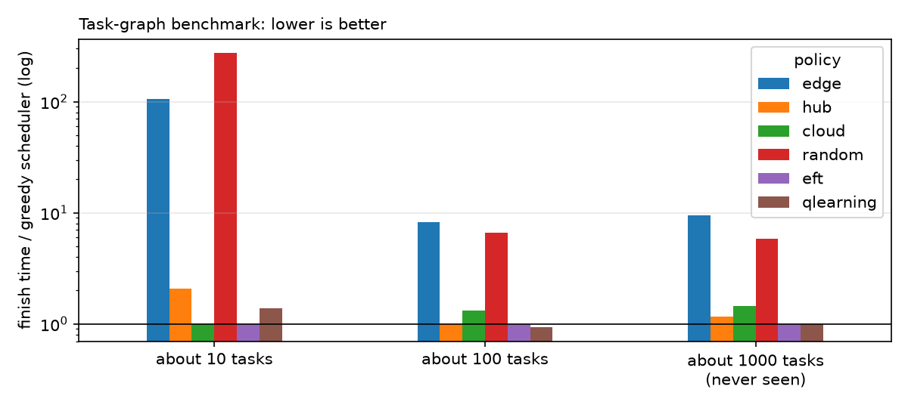

# Task-graph benchmark (Synthetic Task Flow Graphs, doi:10.5281/zenodo.10654551)

A second, public test of the same idea: a table-based Q-learner decides where each task of an application runs (edge / hub / cloud).

Numbers are finish time divided by the finish time of the greedy earliest-finish-time (EFT) scheduler, a strong classic method. 1.00 = same as EFT, lower is better. Average of 5 training runs.

**Plain result:** On the graphs it never saw (about 1000 tasks) Q-learning is level with the greedy scheduler (0.99 of its time). It does not beat it.

## By application size

| group                                     |   edge |   hub |   cloud |   random |   eft |   qlearning |
|:------------------------------------------|-------:|------:|--------:|---------:|------:|------------:|
| about 10 tasks                            | 105.55 |  2.08 |    1    |   276.54 |     1 |        1.39 |
| about 100 tasks                           |   8.31 |  0.99 |    1.32 |     6.67 |     1 |        0.93 |
| about 1000 tasks (never seen in training) |   9.57 |  1.16 |    1.44 |     5.86 |     1 |        0.99 |

## By network condition

| network   |   edge |   hub |   cloud |   random |   eft |   qlearning |
|:----------|-------:|------:|--------:|---------:|------:|------------:|
| good      |  37.17 |  1.29 |    1.21 |    19.68 |     1 |        1.03 |
| busy      |  28.53 |  1.19 |    1.2  |    38.07 |     1 |        1    |
| bad       |  25.31 |  1.39 |    1.46 |   141.37 |     1 |        1.13 |

## Q-learning against the greedy scheduler, case by case

(one case = one graph on one network in one training run)

|                                           |   better |   same |   worse |
|:------------------------------------------|---------:|-------:|--------:|
| about 10 tasks                            |        0 |     41 |      19 |
| about 100 tasks                           |       85 |     13 |      22 |
| about 1000 tasks (never seen in training) |       38 |      7 |      45 |

Average per training run: [1.07, 1.05, 0.97, 1.11, 1.07]

## How to read this honestly

- The about-100-task graphs were used for training, so a good number there is not a fair test. The fair test is the about-1000-task group.
- The about-10-task graphs finish in a fraction of a second, so a large ratio there is a small amount of real time.
- EFT is a hand-made rule that sees exact timings. Q-learning has to learn from experience with a coarse table. Being level with EFT on unseen graphs shows the learner carries over to a different problem; it is not a claim to beat the best schedulers.

