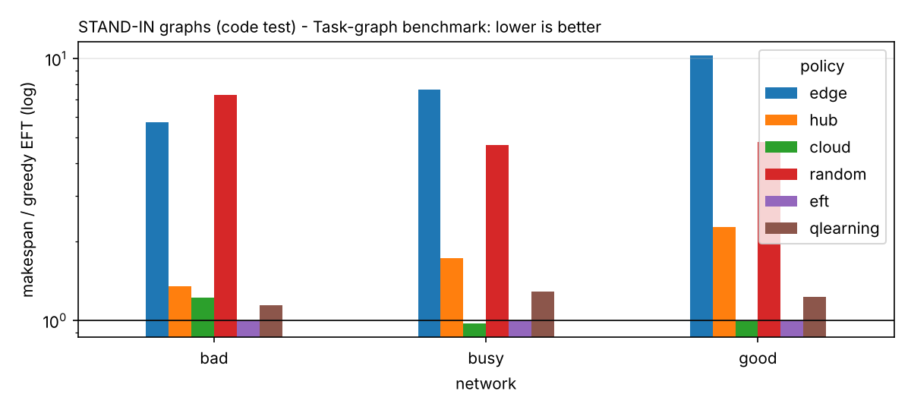

# Task-graph benchmark (STAND-IN data: code test only, NOT the dataset results)

Makespan relative to greedy earliest-finish-time (EFT) list scheduling; 1.00 = same as EFT, lower is better.

## By network condition

| network   |   cloud |   edge |   eft |   hub |   qlearning |   random |
|:----------|--------:|-------:|------:|------:|------------:|---------:|
| bad       |   1.227 |  5.73  |     1 | 1.349 |       1.143 |    7.263 |
| busy      |   0.972 |  7.621 |     1 | 1.733 |       1.292 |    4.69  |
| good      |   0.995 | 10.3   |     1 | 2.277 |       1.228 |    4.796 |

## By graph size (tasks)

|   tasks |   cloud |   edge |   eft |   hub |   qlearning |   random |
|--------:|--------:|-------:|------:|------:|------------:|---------:|
|      10 |   1.079 |  7.564 |     1 | 1.55  |       1.343 |    8.358 |
|     100 |   1.032 |  7.519 |     1 | 1.789 |       1.1   |    3.95  |
|    1000 |   1.083 |  8.568 |     1 | 2.021 |       1.22  |    4.442 |

