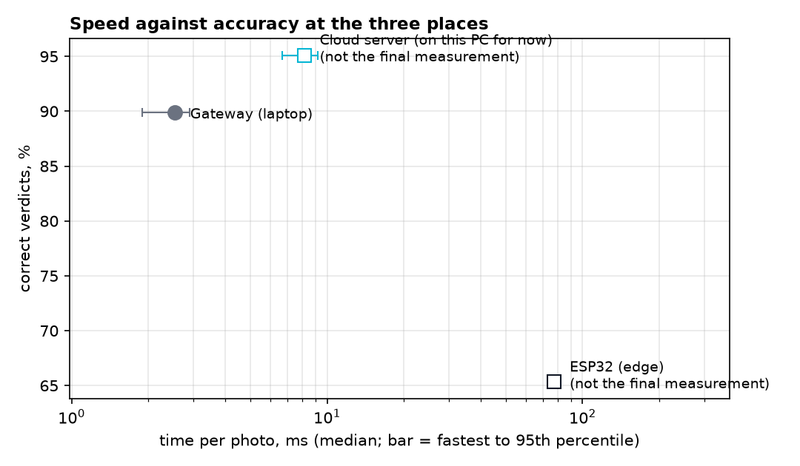

# Speed against accuracy: ESP32, gateway, cloud

Generated 2026-11-25 23:54. The same 594 photos (public photos, `data\public\test`) were checked at all three places. Each place used its own cut-off from the model card.

| place | model | correct verdicts | damaged caught | good wrongly rejected | correct with a plain 50% cut-off | time per photo (median) | 95% under | how it was measured |
|---|---|---|---|---|---|---|---|---|
| ESP32 (edge) | TinyCNN: 4 x 3x3 conv (8, 16, 24, 32), average, 1 output (48x48 grey) | 65.3% | 98.0% | 81.2% | 66.7% | 77.5 ms | 78.1 ms | EMULATED (no board connected): cable time from the baud rate, compute time from 40 ns per multiply |
| Gateway (laptop) | mobilenet_v3_small (128x128 colour) | 89.9% | 96.0% | 18.8% | 91.8% | 2.5 ms | 2.9 ms | this laptop, CPU |
| Cloud server (on this PC for now) | mobilenet_v3_large (160x160 colour) | 95.1% | 98.0% | 9.0% | 96.5% | 8.1 ms | 9.2 ms | server on THIS PC: no Internet in the path, so the real cloud will be slower |

The first three columns use each model's cost-based cut-off (a shipped defect costs ten times a wasted good box, so every cut-off leans toward rejecting; the weaker the model, the more good boxes that costs). The 50% column shows the same model with a neutral cut-off.

What each time includes:
- ESP32 (edge): shrinking the photo, USB cable both ways, tiny model on the ESP32.
- Gateway (laptop): small model on the laptop (no network).
- Cloud server (on this PC for now): JPEG, upload, big model on the server, answer back.

## What the numbers say

- Most accurate first: Cloud server (on this PC for now) 95.1%, Gateway (laptop) 89.9%, ESP32 (edge) 65.3%.
- Fastest first: Gateway (laptop) 3 ms, Cloud server (on this PC for now) 8 ms, ESP32 (edge) 77 ms.
- The ESP32 is both slower (77 ms against 3 ms) and less accurate than the gateway, because the photo has to be sent to it over the cable first. It is not there to win this table. It is there for when the gateway is too busy and the Internet is too slow: then it is the only place that still answers before the box reaches the arm.
- Going from the gateway to the cloud buys 5.2 points of accuracy for 6 ms more per box.

## Read with care

- The ESP32 time is an estimate until this is run with the board plugged in. Its accuracy is exact: the same arithmetic as the firmware.
- The cloud server ran on this same PC, so its time has no Internet in it. Run this again with --server http://<AWS address>:8000 for the real number.

